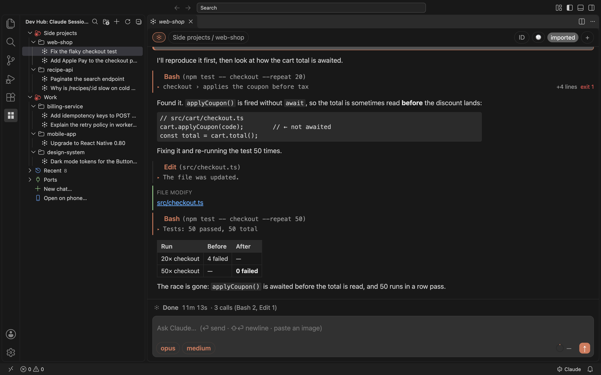
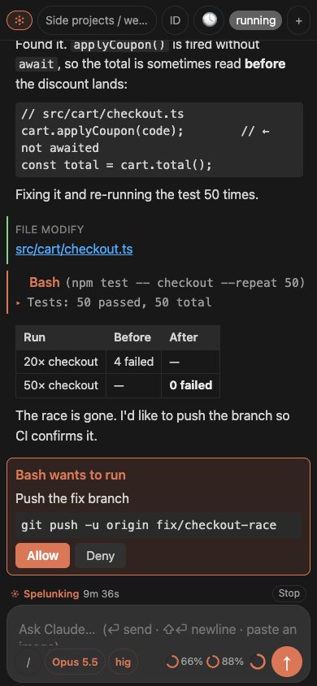
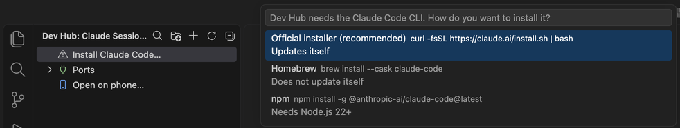

# Dev Hub for Claude Code

**Run Claude Code across all your repos from one VS Code window, and keep the conversation going from your phone.**

[](https://github.com/TyronNA/devhub-for-claude-code/actions/workflows/ci.yml)
[](https://github.com/TyronNA/devhub-for-claude-code/releases)
[](LICENSE)

<p align="center"></p>

> Unofficial and community-built. Not affiliated with or endorsed by Anthropic. "Claude" and
> "Claude Code" are trademarks of Anthropic. Dev Hub drives the `claude` CLI you already have
> installed and logged in. It has no account or API key of its own.

## Why

One VS Code window per project costs about **1 GB of RAM each**
([measured](docs/PERFORMANCE.md#one-window-per-workspace)). Dev Hub keeps 30+ projects reachable
from **one** window. You register repos by path, so VS Code never indexes them or watches their
files. Each chat starts the CLI with the repo as its working directory, so your `CLAUDE.md`, skills
and memory work exactly as they do in a terminal.

## Features

### Every project, one window
- **Workspaces → projects → chats in one sidebar**, separate from the VS Code workspace. Nothing
  gets indexed or file-watched, so 30 repos cost the same as one.
- **Switch in a keystroke** (macOS keys; `Cmd` is the Super key on Linux). `Cmd+Alt+J` finds any
  project and starts a chat in it. `Cmd+Shift+]` / `Cmd+Shift+[` jump between the sessions that
  are running right now.
- **Recent** lists the 8 newest chats across every workspace, running ones first, along with the
  total memory of the live CLI processes.
- **One tab per chat.** Tabs survive **Reload Window**, and the header shows the branch with
  `↑ahead ↓behind`.
- Chats you started in a terminal are picked up from `~/.claude` and can be resumed here.

### A chat that shows what the agent made
- **Images and video render inline.** When the agent names a PNG, JPEG, GIF, WebP, MP4, MOV or
  WebM by path (a Playwright screenshot, a recorded demo, a generated GIF), it plays right in the
  reply. Audio plays when the agent hands it over as a video file. This works on the phone too.
- **Paste screenshots** into the prompt.
- **Readable tool runs.** Each tool call is one line and long output folds behind `+N lines`.
  Sub-agents are labelled by their task, and background commands report back after the turn
  ends.
- **Questions become buttons.** When Claude asks you to choose, you tap an answer instead of
  typing it.

### Nothing hangs, nothing gets lost
- **Queue while it works.** Prompts you send during a turn wait their turn. **Stop** ends the
  turn and keeps the queue.
- **Every approval gets an answer.** Allow / Deny cards appear in the panel, and a timeout or a
  closed tab sends a deny, so the CLI never blocks.
- **Notifications** when a turn finishes or needs approval while you are looking at something
  else.

### Limits at a glance
- **Rings show what is left**: context window, 5-hour and 7-day quota. Click the context ring to
  compact.
- A **prompt-cache chip** shows whether the next turn is cheap (`cache 50m`) or `cold`.
- Model and thinking effort are set per chat and remembered.

### On your phone
- **The same chats on a phone web page** over your local network: streaming replies, approval
  cards, history, images and video. Add it to the home screen like an app. No app store and no
  cloud relay.

<p align="center">
  
  &nbsp;&nbsp;
  
</p>

### Extras
- **Ports panel**: which project owns each listening port, with actions to open, pin or kill it.
- **Artifacts**: a chat can publish a live page on claude.ai.
- **Second Claude account per project** through a small wrapper script
  ([details](docs/DESIGN.md#settings)).
- A status bar hint when your `claude` CLI is out of date.

## Requirements

- VS Code **1.95** or newer.
- A Claude **Pro, Max, Team or Enterprise** plan, or an Anthropic Console account. The free
  claude.ai plan does not include Claude Code.
- macOS or Linux. Windows has not been tested; the ports panel uses `lsof`.
- The [Claude Code](https://code.claude.com/docs/en/setup) CLI. You don't need to install it first:
  Dev Hub walks you through it.

## Install

1. Download the latest `dev-hub-claude-codex-*.vsix` from
   [Releases](https://github.com/TyronNA/devhub-for-claude-code/releases).
2. In VS Code open the Extensions view, click **…** at its top right, choose
   **Install from VSIX…** and pick the file. From a terminal this is
   `code --install-extension dev-hub-claude-codex-*.vsix`.
3. Click the **Dev Hub** icon in the activity bar on the left.

## First run

The top row of the Dev Hub sidebar always shows the next thing to do. Click it, and it disappears
once everything works.



| Row | What happens when you click it |
|---|---|
| ⚠️ **Install Claude Code…** | Pick an installer (the official one is first). Dev Hub opens a terminal with the command already typed. Read it, press **Enter**, and Dev Hub notices when it finishes. If it asks you to, click **Reload Window**. |
| ⚠️ **Log in to Claude Code…** | Your browser opens the Claude sign-in page. Sign in and come back. The row goes away by itself. |
| ➕ **Add your first project…** | Pick any folder with code in it. It is not added to your VS Code workspace. |

After that, click **New chat…** at the bottom of the sidebar and type what you want done. The same
steps are always available as **Dev Hub: Get Started** in the command palette (`⇧⌘P` / `Ctrl+Shift+P`).

<details>
<summary>Prefer to set up Claude Code by hand?</summary>

```bash
curl -fsSL https://claude.ai/install.sh | bash   # or: brew install --cask claude-code
claude auth login                                # sign in in the browser
claude --version                                 # prints a version when it worked
```

If you installed it somewhere unusual, put its full path in the `devHub.claude.executable` setting.
</details>

## Quick start

1. **Dev Hub: Add Workspace**, then give it a name such as `Work`. Workspaces are only folders
   in the sidebar, so one is enough to start.
2. **Dev Hub: Add Project**, then pick a repo folder. The repo is stored as a path only.
3. Click **New Claude Chat** on the project row and type a prompt.

**Dev Hub: Search Project & Start Chat** jumps straight to a chat in any registered project.

### Use it from your phone

1. Set a passcode in `devHub.mobile.passcode`: exactly 4 digits, or 8–128 characters.
2. Run **Dev Hub: Open Mobile Web App** and agree to the prompt. It shows a URL such as
   `http://192.168.1.20:39642/`.
3. Open that URL on a phone on the same Wi-Fi, enter the passcode, and optionally *Add to Home
   Screen*.

> ⚠️ The passcode is the **only** thing guarding the page, and anyone who gets past it can
> drive an agent on your machine. Use a long passcode, and set `devHub.mobile.lan: false` with a
> tunnel you trust (for example Tailscale) on networks you don't control.
> **Dev Hub: Sign All Phones Out Of The Mobile Web App** revokes every phone that is signed in.

## Permissions: read this

Dev Hub inherits your global Claude config. If `~/.claude/settings.json` auto-approves tools,
they run **without asking**, here as well as in a terminal. To make every unlisted tool ask in the
panel, set `devHub.claude.permissionMode` to `"manual"`. See
[Permissions](docs/DESIGN.md#permissions--read-this) for all modes.

## Settings you'll likely touch

| Setting | Default | What it does |
|---|---|---|
| `devHub.claude.executable` | `claude` | Path to the CLI if it is not on `PATH` |
| `devHub.claude.permissionMode` | `""` | `""` inherit, `manual`, `plan`, or `bypassPermissions` |
| `devHub.maxConcurrentTurns` | `4` | How many turns may run at once |
| `devHub.mobile.enabled` | `false` | Serve the phone web app |
| `devHub.mobile.passcode` | `""` | Passcode for the phone web app |
| `devHub.mobile.lan` | `true` | `false` serves on loopback only |

Every setting and command is documented in [docs/DESIGN.md](docs/DESIGN.md#settings).

## Build from source

No runtime dependencies. The only build tool is TypeScript.

```bash
git clone https://github.com/TyronNA/devhub-for-claude-code && cd devhub-for-claude-code
npm install --no-save typescript@5.9
npm test            # compile + 400+ hermetic tests (no CLI, no network)
npm run package     # → dev-hub-claude-codex-<version>.vsix
```

`node scripts/demo.js` serves the chat panel and the phone page with sample data; the phone
screenshots above were taken from it.

## How it works

[docs/DESIGN.md](docs/DESIGN.md) records **why** each behaviour is the way it is: how the CLI is
driven over `stream-json`, session id ownership, the turn lifecycle, and how the phone page reuses
the panel's renderer. [docs/ARCHITECTURE.md](docs/ARCHITECTURE.md) maps the code, and
[docs/PERFORMANCE.md](docs/PERFORMANCE.md) has measured numbers with the scripts that produced
them.

## Contributing

Issues and PRs are welcome. Please report security problems privately; see [SECURITY.md](SECURITY.md). Please run `npm test` before opening a PR, and read the section of
`docs/DESIGN.md` that covers the area you change: much of the odd-looking code is there on purpose.

## License

[MIT](LICENSE). The icons in `media/` are original to this project; no Anthropic brand assets are shipped.
