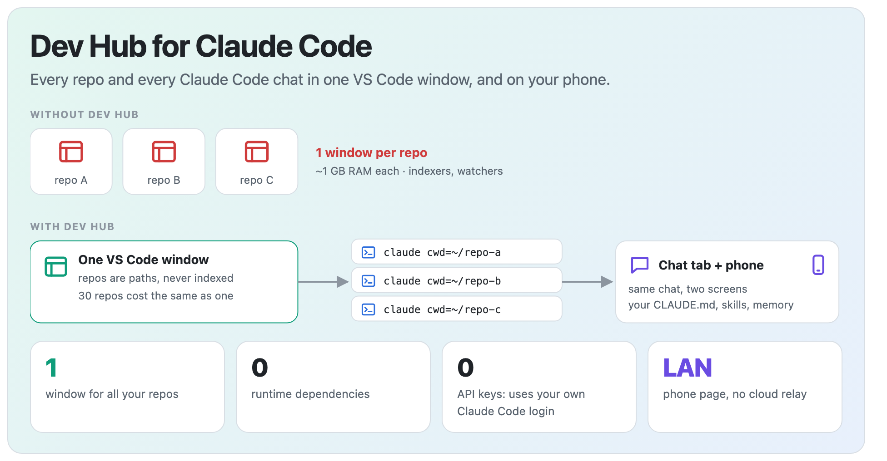
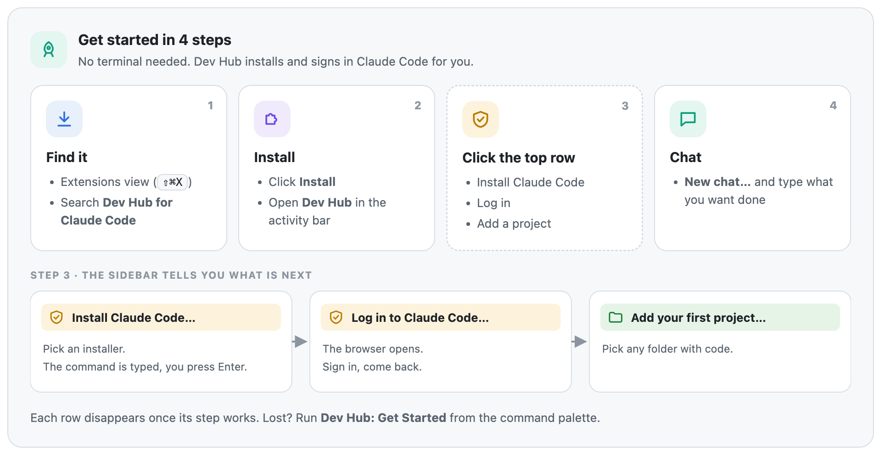
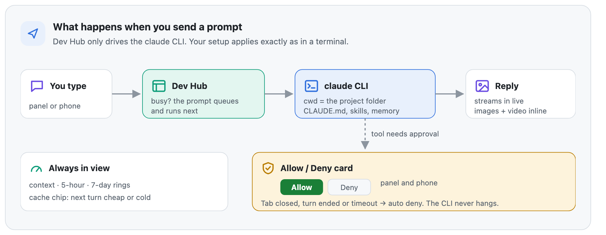
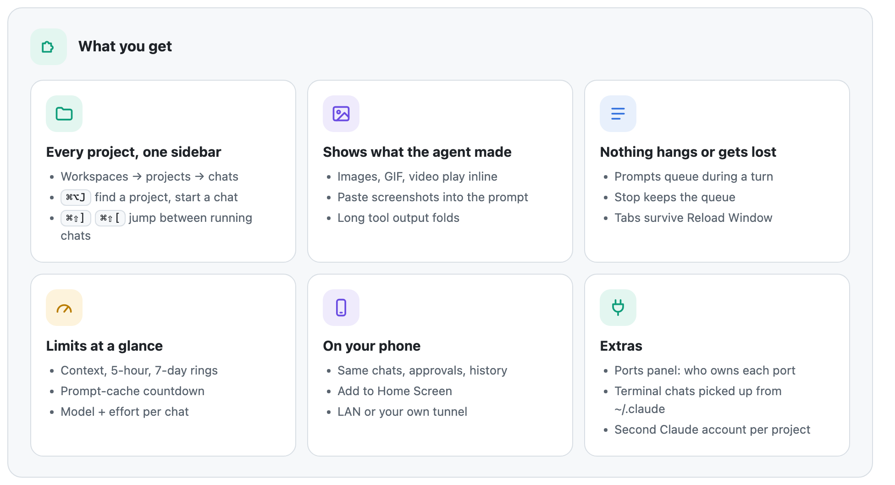
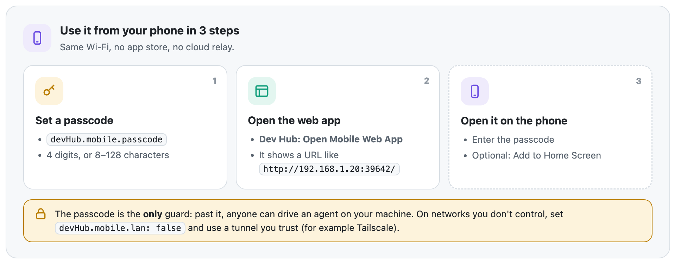
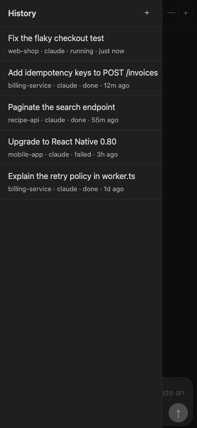

# Dev Hub for Claude Code

**Run Claude Code across all your repos from one VS Code window, and keep the conversation going from your phone.**

[](https://github.com/TyronNA/devhub-for-claude-code/actions/workflows/ci.yml)
[](https://github.com/TyronNA/devhub-for-claude-code/releases)
[](https://marketplace.visualstudio.com/items?itemName=tyronna.dev-hub-claude-codex)
[](LICENSE)

<picture>
  <source media="(prefers-color-scheme: dark)" srcset="https://raw.githubusercontent.com/TyronNA/devhub-for-claude-code/main/docs/images/card-hero-dark.png">
  
</picture>

<p align="center"></p>

> Unofficial and community-built. Not affiliated with or endorsed by Anthropic. "Claude" and
> "Claude Code" are trademarks of Anthropic. Dev Hub drives the `claude` CLI on your machine with
> your own login. It has no account or API key of its own.

## Get started

<picture>
  <source media="(prefers-color-scheme: dark)" srcset="https://raw.githubusercontent.com/TyronNA/devhub-for-claude-code/main/docs/images/card-start-dark.png">
  
</picture>

**[Install from the VS Code Marketplace](https://marketplace.visualstudio.com/items?itemName=tyronna.dev-hub-claude-codex)** (or `code --install-extension tyronna.dev-hub-claude-codex`) · needs VS Code 1.95+, macOS or Linux, and a
Claude Pro / Max / Team / Enterprise plan (the free plan has no Claude Code).

<details>
<summary>Prefer to set up Claude Code by hand?</summary>

```bash
curl -fsSL https://claude.ai/install.sh | bash   # or: brew install --cask claude-code
claude auth login                                # sign in in the browser
claude --version                                 # prints a version when it worked
```

If you installed it somewhere unusual, put its full path in the `devHub.claude.executable` setting.
</details>

**Codex too, optionally.** With the [Codex CLI](https://developers.openai.com/codex/cli) installed and
signed in, **Dev Hub: New Codex Chat** opens a Codex chat in the same panel and phone page. It
edits the project folder without asking (`devHub.codex.sandbox` = `workspace-write`, because
`codex exec` cannot show approval prompts); set it to `read-only` for analysis only. Codex is a
trademark of OpenAI; Dev Hub is not affiliated with OpenAI either.

## How it works

<picture>
  <source media="(prefers-color-scheme: dark)" srcset="https://raw.githubusercontent.com/TyronNA/devhub-for-claude-code/main/docs/images/card-flow-dark.png">
  
</picture>

## What you get

<picture>
  <source media="(prefers-color-scheme: dark)" srcset="https://raw.githubusercontent.com/TyronNA/devhub-for-claude-code/main/docs/images/card-features-dark.png">
  
</picture>

## On your phone

<picture>
  <source media="(prefers-color-scheme: dark)" srcset="https://raw.githubusercontent.com/TyronNA/devhub-for-claude-code/main/docs/images/card-phone-dark.png">
  
</picture>

<p align="center">
  
  &nbsp;&nbsp;
  
</p>

## Permissions: read this

Dev Hub inherits your global Claude config. If `~/.claude/settings.json` auto-approves tools,
they run **without asking**, here as well as in a terminal. To make every unlisted tool ask in the
panel, set `devHub.claude.permissionMode` to `"manual"`. See
[Permissions](docs/DESIGN.md#permissions--read-this) for all modes.

## Settings you'll likely touch

| Setting | Default | What it does |
|---|---|---|
| `devHub.claude.executable` | `claude` | Path to the CLI if it is not on `PATH` |
| `devHub.claude.permissionMode` | `""` | `""` inherit, `manual`, `plan`, or `bypassPermissions` |
| `devHub.codex.sandbox` | `workspace-write` | `read-only` keeps Codex from writing files |
| `devHub.maxConcurrentTurns` | `4` | How many turns may run at once |
| `devHub.mobile.enabled` | `false` | Serve the phone web app |
| `devHub.mobile.passcode` | `""` | Passcode for the phone web app |
| `devHub.mobile.lan` | `true` | `false` serves on loopback only |

Every setting and command is documented in [docs/DESIGN.md](docs/DESIGN.md#settings).

## Build from source

No runtime dependencies. The only build tool is TypeScript.

```bash
git clone https://github.com/TyronNA/devhub-for-claude-code && cd devhub-for-claude-code
npm install --no-save typescript@5.9
npm test            # compile + 400+ hermetic tests (no CLI, no network)
npm run package     # → dev-hub-claude-codex-<version>.vsix
```

`node scripts/demo.js` serves the chat panel and the phone page with sample data; the phone
screenshots above were taken from it.

## Design docs

[docs/DESIGN.md](docs/DESIGN.md) records **why** each behaviour is the way it is: how the CLI is
driven over `stream-json`, session id ownership, the turn lifecycle, and how the phone page reuses
the panel's renderer. [docs/ARCHITECTURE.md](docs/ARCHITECTURE.md) maps the code, and
[docs/PERFORMANCE.md](docs/PERFORMANCE.md) has measured numbers with the scripts that produced
them.

## Contributing

Issues and PRs are welcome. Please report security problems privately; see [SECURITY.md](SECURITY.md). Please run `npm test` before opening a PR, and read the section of
`docs/DESIGN.md` that covers the area you change: much of the odd-looking code is there on purpose.

## Support

Dev Hub is free and MIT. If it saves you time, a tip keeps it going:

**USDT on TRON (TRC20):** `TPUmiba6BHzfLQ8HNnyS8H4jjNksmDNg6J`

> Send only USDT, and only on the TRON (TRC20) network. Anything else sent to this address is lost.

A ⭐ on GitHub or a review on the [Marketplace](https://marketplace.visualstudio.com/items?itemName=tyronna.dev-hub-claude-codex&ssr=false#review-details) helps just as much.

## License

[MIT](LICENSE). The icons in `media/` are original to this project; no Anthropic brand assets are shipped.
