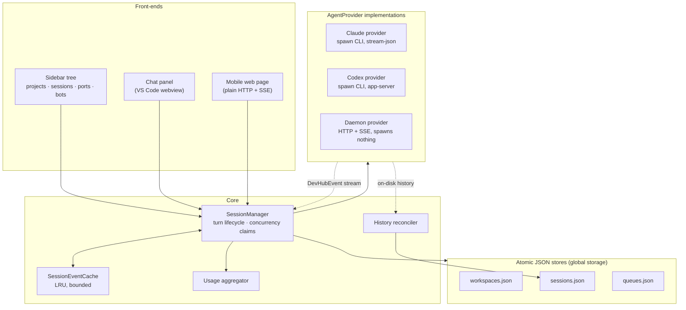
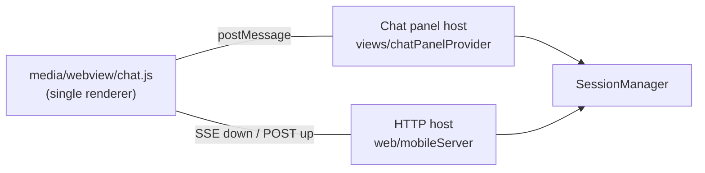

# Dev Hub — Architecture Overview

A single VS Code window that runs many coding-agent CLI sessions across many repositories,
without adding any of those repositories as workspace folders.

Registered projects are **paths only**. Every chat spawns (or attaches to) an agent CLI with that
path as `cwd`. The extension owns lifecycle, transcript, permissions and presentation; it owns
none of the agent's intelligence.

- ~5.4k lines of TypeScript, **zero runtime dependencies, zero devDependencies** (`node_modules/`
  holds the compiler and nothing else). Everything is `node:` builtins.
- Three front-ends, one renderer. Three agent backends, one event type.

---

## 1. The shape



Wiring lives in one file (`src/extension.ts`): it constructs the stores, the providers, the
manager, the tree, the panel and — lazily — the HTTP server, then connects them with **callbacks
rather than a DI container**. Components take closures, not references, because construction order
and the answer to "who is showing this session right now?" are two different questions.

---

## 2. The two seams that make it work

### Seam A — `AgentProvider`

```ts
interface AgentProvider {
  readonly id: ProviderId;
  isAvailable(): Promise<boolean>;
  start(input: StartSessionInput): Promise<ProviderTurnHandle>;
  resume(input: ResumeSessionInput): Promise<ProviderTurnHandle>;
  discoverHistory(projects: DevHubProject[], signal?): Promise<DevHubSession[]>;
  loadTranscript(session: DevHubSession, signal?): Promise<DevHubEvent[]>;
}

interface ProviderTurnHandle {
  events: AsyncIterable<DevHubEvent>;   // the whole contract for a turn
  cancel(): Promise<void>;
  getNativeSessionId(): string | undefined;
}
```

Everything above the providers speaks `DevHubEvent` and nothing else. **A new agent CLI is a new
provider file — not a change in the manager, the tree, or the renderer.**

The proof that the seam is real: the third provider *spawns no process at all*. It talks HTTP+SSE
to a long-running local daemon. The interface only ever promised an `AsyncIterable`, never a
subprocess, so the panel, the tree and the mobile server took it unmodified.

### Seam B — `DevHubEvent`

One discriminated union, ~15 members, is the entire vocabulary between backends and UI:

| Group | Members | Note |
|---|---|---|
| Conversation | `user_message`, `assistant_delta`, `assistant_message`, `assistant_view` | `assistant_view` **replaces** rather than appends — some backends edit one message in place instead of streaming deltas |
| Work | `tool_started` / `tool_completed`, `command_started` / `command_completed`, `file_changed` | started/completed pair by `callId` so the UI updates one row instead of printing two |
| Meta | `thinking`, `usage`, `warning`, `error`, `turn_done` | `thinking` is progress only, never persisted to the transcript |
| Media | `assistant_image` | file path preferred, `data:` URI as the fallback path |

---

## 3. Session identity is not uniform — and that is designed for

Three backends, three ownership models:

| Backend | Who mints the session id | Consequence |
|---|---|---|
| Spawn-style A | **Dev Hub** mints it and passes it on the command line | id known before the first byte of output |
| Spawn-style B | **The CLI** assigns it and reveals it mid-stream | session starts under a `pending:<uuid>` key; when the real id arrives, the manager **rekeys** the store, the event cache and the open tab in one step |
| Daemon | The **daemon's** conversation id | the same id on two different daemons is two different conversations, so the session also carries its endpoint — the store key is `provider + id`, scoped by endpoint |

This is the kind of asymmetry most abstractions try to hide and then leak. Here it is named:
one rekey path, one scoping rule, both tested.

---

## 4. Concurrency: a claim, not a counter

Naive counting is wrong because `provider.start()` contains awaits (availability probe, spawn)
before anything lands in the active map — N turns can race through the gate.

```
reserveSlot()   → reserve BEFORE the awaits, release in finally   (global limit)
claim(session)  → per-session lock, so two resumes cannot stack on one thread
isBusy()        → the only correct "can I send?" question
```

`cancel()` writes status `cancelled` **immediately**, while the consume loop only clears the
active entry in its `finally` after draining the stream. In that window the status says idle and
the session is not. Anything that reads status to decide whether to send a turn is a bug —
callers ask `isBusy()`.

A separate `withSessionLock()` covers out-of-turn operations (e.g. context compaction, which can
take a minute) — it locks the session but deliberately does **not** consume a concurrency slot,
because it is not a turn.

---

## 5. Two front-ends, one renderer



The phone is not a mirrored webview — VS Code webviews are iframes served from a CDN origin with
a service worker, which mobile Safari will not run. So the same renderer script is served as a
**plain HTTP page** instead, over a different pipe: SSE downward, POST upward, identical message
protocol. The mobile protocol module may only *add* messages on top of the panel protocol; the
shared validator is never loosened.

The cost of one renderer is a standing rule: a behaviour change in one host almost always needs
the other.

**Renderer constraints (both hosts):**
- DOM is built with `createElement` only — **no `innerHTML` anywhere**. Agent output is untrusted markup.
- Panel CSP is `default-src 'none'` + nonce; the HTTP page carries an equivalent `'self'` policy
  (`data:` opened for images only, because some transcripts embed pasted images as data URIs).
- Image serving is restricted to exactly two directories.
- The script runs in the *viewer's* browser, so no syntax newer than old WebKit — a test greps the
  shipped file for modern regex features to enforce it.

---

## 6. Blocking-request handling (the permission contract)

An agent CLI asking "may I run this?" **blocks** until answered. So the invariant is absolute:

> Every permission request is answered. Deny on tab close, panel dispose, turn end, or timeout.

Routing order matters and is explicit: **the phone is offered the request first** — it only
accepts if a real client currently holds that session, and a person at their phone cannot see the
desktop panel to approve anything. Only then the panel. Only then a notification, and only if the
session is not the one already on screen.

---

## 7. Persistence

Three atomic JSON files under the extension's global storage. Atomic = write to a
`pid.timestamp.random` temp file, then `rename`.

- **workspaces.json** — logical workspaces → registered project paths (normalized via `realpath`,
  case-folded on case-insensitive filesystems).
- **sessions.json** — session rows: provider, native id, project, title, status, usage.
- **queues.json** — prompts typed but never sent. Restored as **text handed back to the user**,
  never re-queued. A queue from a window you closed three days ago silently executing itself is
  not a feature.

There is no database, no index, no migration engine. Session *content* is not duplicated: the
agent CLIs already write their own transcripts to disk, so providers discover and parse those, and
a reconciler merges what was found against what the store already knows.

**Memory is bounded on purpose:** the event cache is an LRU over a small number of sessions with a
per-session event ceiling — old sessions evict, long sessions truncate from the front.

---

## 8. Beyond chat

Two subsystems that share the tree but not the provider stack:

- **Long-running bots** — registered by directory plus four verbs (`start` / `stop` / `status` /
  `logs`, defaulting to `make <verb>`), executed with a timeout. State comes from parsing the
  status output; some bots additionally expose task rows over their own loopback API and are read
  read-only.
- **Listening ports** — an `lsof` scan of the current user's listening sockets, grouped by owning
  project via each process's `cwd`, falling back to owning bot, then to a pinned list. No root, so
  the scan sees only your own processes — which is exactly the intended scope.

---

## 9. What the design optimizes for

| Decision | Reason |
|---|---|
| Zero dependencies | The whole thing is auditable; supply chain is the compiler |
| Paths, not workspace folders | 20 repos in one window without 20 language servers |
| One event union | New agent CLI = one new file |
| Claims over counters | The only correct answer under real async |
| One renderer, two transports | Never maintain two transcript renderers |
| Deny-by-default on every exit path | A blocked CLI must never be left hanging |
| Typed-but-unsent prompts returned as text | Restore must not equal execute |
| Comments carry the *why*, not the *what* | Most of the odd-looking code is load-bearing, and the reason is written down next to it |

---

*Local-only extension; never published to a marketplace. Product and deployment specifics have
been omitted from this document.*
